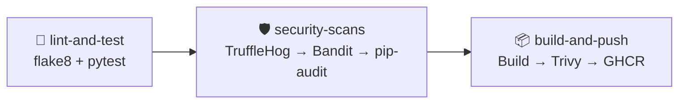

<div align="center">

# 🍔 FastOrder API

### Pipeline DevSecOps com Flask, Docker e GitHub Actions

Testes automáticos • Segurança contínua • Feature Flags • Release automatizado

[](https://github.com/jeffin872/pratica-ci-github-actions/actions/workflows/devsecops-pipeline.yml)


</div>

---

## 📖 Sobre o projeto

API de exemplo desenvolvida para a disciplina **ADS0024**, com foco na prática de **Integração Contínua (CI)** e **DevSecOps**.

A cada `push`, uma esteira automatizada testa o código, realiza varreduras de segurança e, somente após a aprovação das verificações, constrói e publica a imagem Docker.

| Estudo | Tema |
|---|---|
| 🧪 **Estudo Guiado 01** | Pipeline de CI: lint, testes unitários e build Docker |
| 🛡️ **Estudo Guiado 02** | Esteira DevSecOps: Secret Scanning, SAST, SCA, scan de imagem, Feature Flag e release no GHCR |

## 📑 Sumário

- [🛠️ Tecnologias](#️-tecnologias)
- [🌐 Rotas da API](#-rotas-da-api)
- [🚩 Feature Flag](#-feature-flag)
- [▶️ Como rodar](#️-como-rodar)
- [✅ Testes e verificações](#-testes-e-verificações)
- [⚙️ Pipeline](#️-pipeline)
- [📦 Imagem publicada](#-imagem-publicada)
- [📁 Estrutura do projeto](#-estrutura-do-projeto)
- [👥 Autoria](#-autoria)

---

## 🛠️ Tecnologias

| Para quê | Ferramenta |
|---|---|
| 🐍 **API** | Python 3.12 e Flask |
| 🧪 **Testes** | pytest e pytest-flask |
| 🧹 **Lint** | flake8 |
| 🐳 **Contêiner** | Docker |
| 🤖 **Automação** | GitHub Actions |
| 🔑 **Secret Scanning** | TruffleHog |
| 🔍 **SAST (código)** | Bandit |
| 📚 **SCA (dependências)** | pip-audit |
| 🛡️ **Scan de imagem** | Trivy |
| 📦 **Registro** | GitHub Container Registry (GHCR) |

## 🌐 Rotas da API

| Método | Rota | Descrição |
|:---:|---|---|
| `GET` | `/` | Mensagem de boas-vindas |
| `GET` | `/api/status` | Estado do serviço e das Feature Flags |
| `GET` | `/api/soma?a=10&b=5` | Soma dois números e retorna `{"resultado": 15}`. Entrada inválida retorna `400`. |
| `GET` | `/api/desconto?preco=100` | Aplica 10% de desconto. **Só funciona com a Feature Flag ligada**, caso contrário retorna `404`. |

**Exemplo de resposta** (`/api/desconto?preco=100` com a flag ligada):

```json
{
  "preco_original": 100.0,
  "desconto_percentual": 10,
  "preco_final": 90.0
}
```

## 🚩 Feature Flag

A rota `/api/desconto` é controlada pela variável de ambiente `FEATURE_DESCONTO_PROMO`:

| Valor | Efeito |
|---|---|
| `true` | ✅ A rota responde normalmente |
| `false` ou ausente | 🚫 A rota responde `404` (padrão) |

> [!NOTE]
> Isso separa o **deploy** (o código já está em produção) do **release** (a funcionalidade liberada para os usuários).
>
> É o chamado **Dark Launch**: a funcionalidade existe, mas fica escondida até alguém ligar a chave.
>
> A flag é lida a cada requisição, direto do ambiente. Portanto, mudar seu valor não exige alterar o código nem gerar uma nova imagem: basta reiniciar o contêiner com a variável nova (sem rollback e sem novo build).

## ▶️ Como rodar

### 📋 Pré-requisitos

- Python 3.12+
- Git
- Docker (opcional, caso rode em contêiner)

### 1. Clone o repositório

```bash
git clone https://github.com/jeffin872/pratica-ci-github-actions.git

cd pratica-ci-github-actions
```

### 2. 💻 Executando localmente

Crie e ative um ambiente virtual:

**Linux/macOS:**

```bash
python -m venv venv
source venv/bin/activate
```

**Windows (PowerShell):**

```powershell
python -m venv venv
venv\Scripts\Activate.ps1
```

Instale as dependências:

```bash
pip install -r requirements.txt
```

Inicie a API com a Feature Flag desligada:

```bash
python app.py
```

Para iniciar com a Feature Flag ligada:

**Linux/macOS:**

```bash
FEATURE_DESCONTO_PROMO=true python app.py
```

**Windows (PowerShell):**

```powershell
$env:FEATURE_DESCONTO_PROMO="true"
python app.py
```

A API estará disponível em:

- http://localhost:5000/
- http://localhost:5000/api/status
- http://localhost:5000/api/soma?a=10&b=5
- http://localhost:5000/api/desconto?preco=100

### 3. ⚙️ Variáveis de ambiente

| Variável | Padrão | Para quê |
|---|---|---|
| `FEATURE_DESCONTO_PROMO` | `false` | Liga ou desliga a rota de desconto |
| `FLASK_HOST` | `127.0.0.1` | Endereço em que a API escuta |
| `PORT` | `5000` | Porta da API |
| `FLASK_DEBUG` | `0` | Use `1` apenas em desenvolvimento local |

### 4. 🐳 Executando com Docker

Construa a imagem:

```bash
docker build -t fastorder-api .
```

Execute com a flag desligada (padrão):

```bash
docker run -p 5000:5000 fastorder-api
```

Execute com a flag ligada:

```bash
docker run -p 5000:5000 -e FEATURE_DESCONTO_PROMO=true fastorder-api
```

## ✅ Testes e verificações

Execute localmente antes de enviar alterações para o GitHub, garantindo que a esteira tenha maiores chances de passar:

```bash
# 🧪 Testes unitários
pytest -v

# 🧹 Lint (mesmo comando da pipeline)
flake8 . --count --select=E9,F63,F7,F82 --show-source --statistics

# 🔍 SAST
bandit -r . -x ./venv,./test_app.py

# 📚 SCA
pip-audit -r requirements.txt
```

## ⚙️ Pipeline

O arquivo `devsecops-pipeline.yml` é executado a cada `push` ou `pull request` na branch `main`, com três jobs em sequência:



### Etapas da pipeline

| Job | O que faz |
|---|---|
| 🧪 **lint-and-test** | Instala as dependências, executa o `flake8` e roda os testes com `pytest`. |
| 🛡️ **security-scans** | Executa, em ordem, TruffleHog (segredos), Bandit (SAST) e pip-audit (SCA). Se um passo falhar, os seguintes não rodam. |
| 📦 **build-and-push** | Constrói a imagem, realiza o scan com Trivy (CRITICAL e HIGH) e publica no GHCR (apenas em `push`). |

> [!IMPORTANT]
> O job `build-and-push` possui a dependência `needs: [lint-and-test, security-scans]`.
>
> Se qualquer verificação falhar, nenhuma imagem será publicada.
>
> Esse é o **Quality Gate** da esteira: código com verificações reprovadas é barrado antes de chegar ao registro.

## 📦 Imagem publicada

Após um `run` bem-sucedido na branch `main`, a imagem fica disponível no GitHub Container Registry (GHCR).

Para baixá-la:

```bash
docker pull ghcr.io/jeffin872/pratica-ci-github-actions:latest
```

> [!NOTE]
> Pacotes novos no GHCR costumam nascer **privados**. Se o `pull` for negado, torne o pacote público em *Packages > Package settings > Change visibility* ou faça `docker login ghcr.io` antes.

## 📁 Estrutura do projeto

```text
.
├── .github/
│   └── workflows/
│       └── devsecops-pipeline.yml  # Esteira CI/CD
├── app.py                          # API Flask com Feature Flag
├── test_app.py                     # Testes automatizados
├── README.md                       # Este arquivo
├── requirements.txt                # Dependências
├── Dockerfile                      # Empacotamento da API
└── .gitignore
```

## 👥 Autoria

Projeto desenvolvido para fins acadêmicos na disciplina **ADS0024**.

**Repositório:** [FastOrder API - GitHub](https://github.com/jeffin872/pratica-ci-github-actions)